# Top Bar Hider for Karoo

**A calmer ride screen.** Top Bar Hider is a Karoo extension that hides ride time, battery and clock at the top of
the ride screen behind a black bar – while you ride, if you like only on the map page. A data field brings them back
with a tap whenever you want to look.

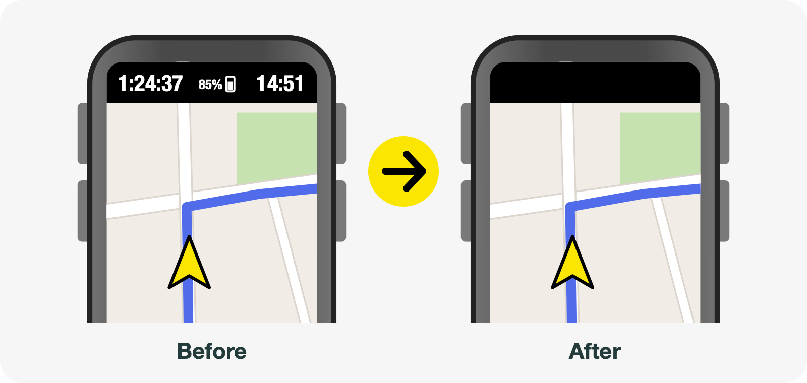

[Deutsch weiter unten ↓](#deutsch)

## Features

- **Hides the top line** – ride time, battery and clock at the top of the ride screen disappear behind a black bar,
  only while a ride is recording or paused.
- **Any data pages** – on all of them, only on the map page, or on all but the map page.
- **Data field** – *TOP BAR* on a data page: tap it to show the top line or hide it again (it stays that way, also on
  the next ride), or let a timer hide it again by itself after a few seconds.
- **Pauses** – optionally show the top line while the ride is paused, and also on auto-pause (e.g. at traffic lights).
- **Alerts stay readable** – alerts appear at the top of the ride screen, right where the bar is. The bar makes room
  for them: for alerts of extensions that ask for room themselves (for example Karoo Reminder, Route Graph, Tile
  Hunting), and – with the optional accessibility service – for every alert, Karoo's own included.
- **Private** – no internet permission, nothing leaves your Karoo.
- English and German, following your Karoo's setting.

## Screenshots

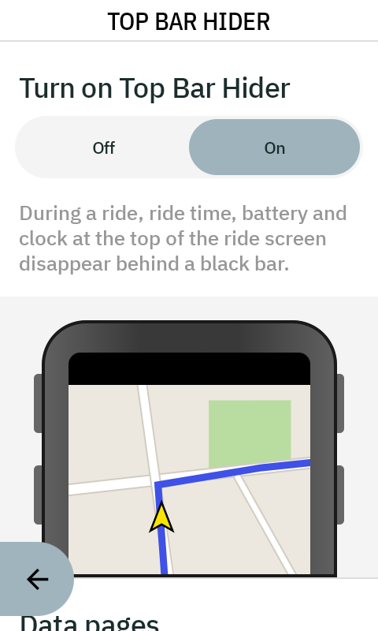
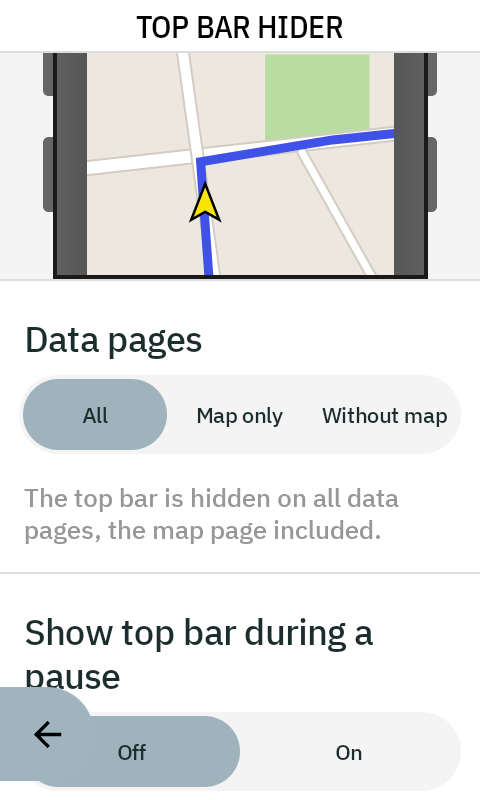
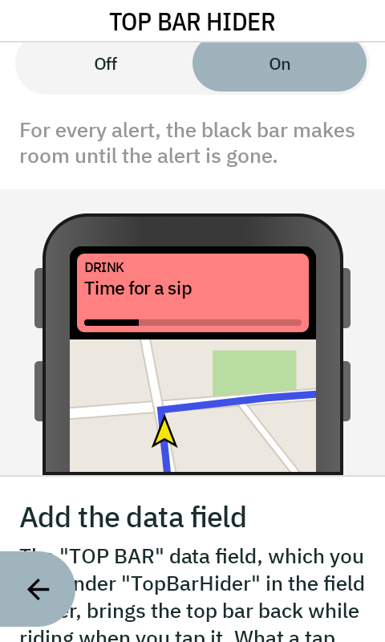
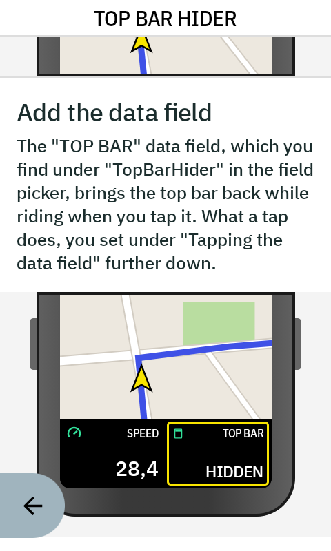
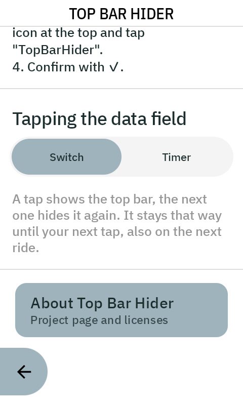

## Installation

Made for the **Karoo 3** (tested there).

1. On your phone, open the [latest release](https://github.com/Zalvato/Karoo-TopBarHider/releases/latest).
2. Long-press **TopBarHider-x.y.apk** and share the link with the **Hammerhead Companion app**. The Karoo downloads
   the APK itself, so it needs internet – Wi-Fi or your phone's hotspot.
3. The Karoo installs Top Bar Hider. You'll find it under *Extensions*.

New versions appear here as a new release. Install them the same way – your settings stay.

## Getting started

1. **Turn it on** – open Top Bar Hider and switch *Turn on Top Bar Hider* to *On*. The picture shows what changes.
2. **Step 1 – permission** – Top Bar Hider draws the black bar over the ride screen, which Android calls
   *Display over other apps*. Tap *Grant permission*, tap *Top Bar Hider* in the list and turn on *Allow display over
   other apps*. Then go back.
3. **Step 2 – show alerts in full** *(optional)* – so that the bar makes room for every alert, set up the
   accessibility service: tap *Set up accessibility*, tap *Top Bar Hider* under *Downloaded apps*, turn on *Use Top Bar
   Hider* (the *shortcut* below it stays off), then **scroll all the way down** in the window that opens (its text is
   invisible on the Karoo) and tap *Allow*. If you don't care about alerts, tap *Later* and leave it off.
4. **Add the data field** – in your Karoo's profile, edit a data page, add a field, pick the puzzle icon and
   *TopBarHider*. On the data page it is called *TOP BAR*.

In the app you can also choose on which data pages the bar shows, whether the top line comes back during a pause, and
what a tap on the data field does: *Switch* (shows or hides, until your next tap) or *Timer* (shows for a few seconds).

## Privacy

Top Bar Hider has no internet permission. It keeps its settings on your Karoo and sends nothing anywhere.

- *Display over other apps* is only used to draw the black bar.
- The optional accessibility service sees the ride screen only: Android delivers it nothing from any other app. It
  only checks whether the ride app is showing an alert, nothing else. Android warns about every accessibility service
  that it can read the screen – that is the general warning for this kind of permission.

## Good to know

- **Force-stopping the app** in Android's app settings switches its accessibility service off – turn it on again in the
  app (*Show alerts in full*). Updating the app does not.
- Without the accessibility service, the bar still covers the top of alerts from extensions that don't ask for room.
- Made for the Karoo 3's ride screen; other devices are untested.

## Questions and problems

Found a bug or have an idea? Please open an [issue](https://github.com/Zalvato/Karoo-TopBarHider/issues).

Enjoying Top Bar Hider?

Top Bar Hider is free. Use it at your own risk – it only covers part of the screen and changes nothing about
your ride data, but check that the alerts you rely on stay readable.

Top Bar Hider is a private project and not affiliated with Hammerhead or SRAM. “Karoo” and “Hammerhead” are
trademarks of their respective owners.

---

## Deutsch

# Top Bar Hider für Karoo

**Ein ruhigerer Fahrt-Bildschirm.** Top Bar Hider ist eine Karoo-Erweiterung, die Fahrzeit, Akku und Uhr oben auf dem
Fahrt-Bildschirm hinter einem schwarzen Balken versteckt – während der Fahrt, auf Wunsch nur auf der Kartenseite. Ein
Datenfeld holt sie mit einem Antippen zurück, wenn du doch einmal schauen willst.

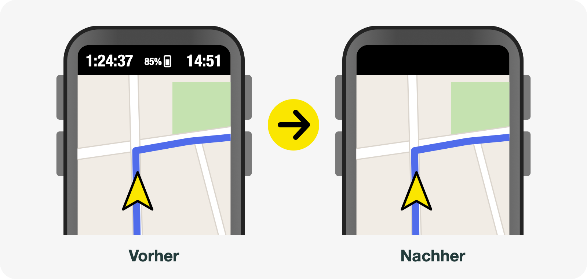

### Funktionen

- **Versteckt die Kopfzeile** – Fahrzeit, Akku und Uhr oben auf dem Fahrt-Bildschirm verschwinden hinter einem
  schwarzen Balken, nur während eine Fahrt aufgezeichnet wird oder pausiert ist.
- **Beliebige Daten-Seiten** – auf allen, nur auf der Kartenseite oder auf allen außer der Kartenseite.
- **Datenfeld** – *TOP BAR* auf einer Daten-Seite: Antippen zeigt die Kopfzeile oder versteckt sie wieder (es bleibt so,
  auch bei der nächsten Fahrt), oder ein Timer versteckt sie nach ein paar Sekunden von selbst wieder.
- **Pausen** – auf Wunsch ist die Kopfzeile während einer Pause sichtbar, auch bei Auto-Pause (z. B. an der Ampel).
- **Warnungen bleiben lesbar** – Warnungen erscheinen oben auf dem Fahrt-Bildschirm, genau wo der Balken liegt. Der
  Balken macht dafür Platz: bei Warnungen von Erweiterungen, die selbst Platz anfordern (zum Beispiel Karoo Reminder,
  Route Graph, Tile Hunting), und – mit der optionalen Bedienungshilfe – bei jeder Warnung, auch bei Karoos eigenen.
- **Privat** – keine Internet-Berechtigung, nichts verlässt deinen Karoo.
- Englisch und Deutsch, passend zur Einstellung deines Karoo.

### Screenshots

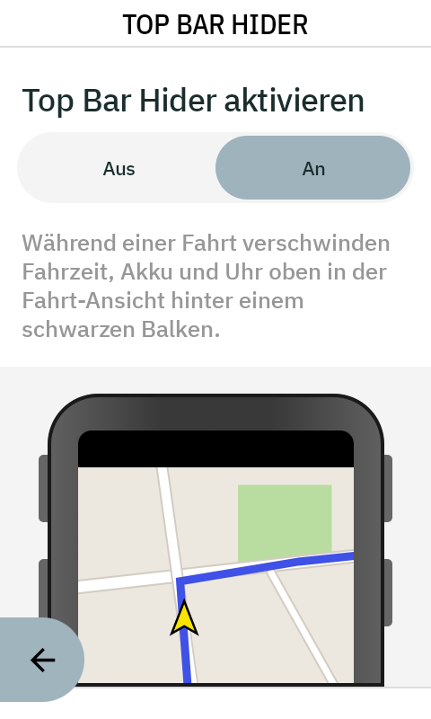
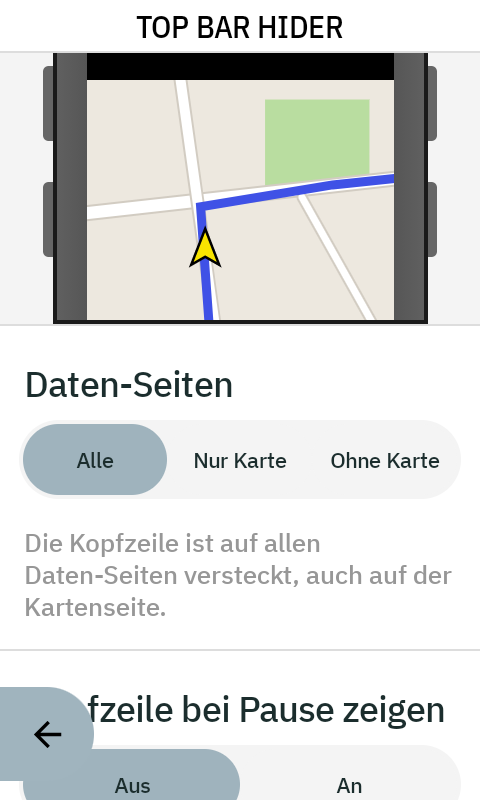
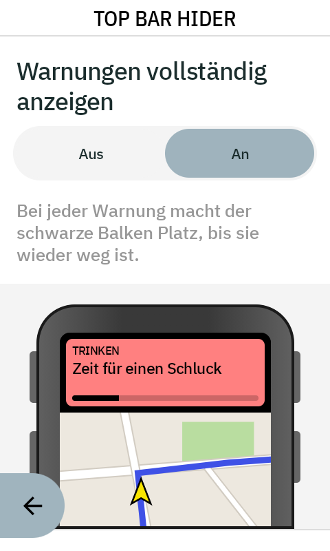
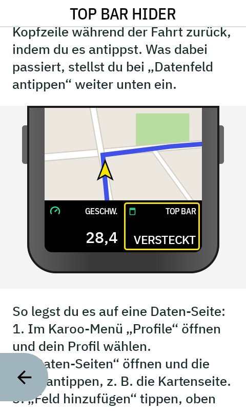
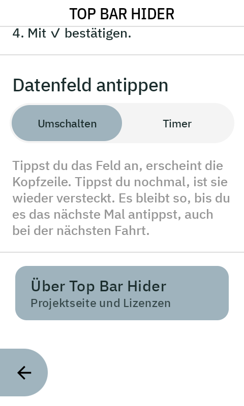

### Installation

Gemacht für den **Karoo 3** (dort getestet).

1. Öffne auf deinem Handy die [neueste Version](https://github.com/Zalvato/Karoo-TopBarHider/releases/latest).
2. Halte **TopBarHider-x.y.apk** gedrückt und teile den Link mit der **Hammerhead Companion App**. Der Karoo lädt die
   APK selbst herunter, braucht also Internet – WLAN oder den Hotspot deines Handys.
3. Der Karoo installiert Top Bar Hider. Du findest es unter *Erweiterungen*.

Neue Versionen erscheinen hier als neue Version. Installiere sie genauso – deine Einstellungen bleiben.

### Erste Schritte

1. **Einschalten** – öffne Top Bar Hider und stelle *Top Bar Hider aktivieren* auf *An*. Das Bild zeigt, was sich ändert.
2. **Schritt 1 – Erlaubnis** – Top Bar Hider zeichnet den schwarzen Balken über den Fahrt-Bildschirm, was Android
   *Über anderen Apps einblenden* nennt. Tippe auf *Erlaubnis geben*, in der Liste auf *Top Bar Hider* und schalte
   *Einblendung über anderen Apps zulassen* ein. Dann zurück.
3. **Schritt 2 – Warnungen vollständig anzeigen** *(optional)* – damit der Balken bei jeder Warnung Platz macht, richte
   die Bedienungshilfe ein: Tippe auf *Bedienungshilfe einrichten*, unter *Heruntergeladene Apps* auf *Top Bar Hider*,
   schalte *Top Bar Hider verwenden* ein (die *Verknüpfung* darunter bleibt aus), dann **ganz nach unten scrollen** im
   Fenster, das sich öffnet (der Text darin ist auf dem Karoo unsichtbar), und *Zulassen* tippen. Sind dir Warnungen
   egal, tippe auf *Später* und lass es aus.
4. **Datenfeld hinzufügen** – bearbeite in deinem Karoo-Profil eine Daten-Seite, füge ein Feld hinzu, wähle das
   Puzzle-Symbol und *TopBarHider*. Auf der Daten-Seite heißt es *TOP BAR*.

In der App stellst du außerdem ein, auf welchen Daten-Seiten der Balken erscheint, ob die Kopfzeile in einer Pause
zurückkommt und was das Antippen des Datenfelds bewirkt: *Umschalten* (zeigt oder versteckt, bis zum nächsten
Antippen) oder *Timer* (zeigt für ein paar Sekunden).

### Datenschutz

Top Bar Hider hat keine Internet-Berechtigung. Es speichert seine Einstellungen auf deinem Karoo und sendet nichts
irgendwohin.

- *Über anderen Apps einblenden* wird nur benutzt, um den schwarzen Balken zu zeichnen.
- Die optionale Bedienungshilfe sieht nur den Fahrt-Bildschirm: Android liefert ihr nichts von anderen Apps. Sie
  prüft nur, ob die Ride-App gerade eine Warnung zeigt, sonst nichts. Android warnt bei jeder Bedienungshilfe, dass sie
  den Bildschirm lesen kann – das ist die allgemeine Warnung für diese Art von Berechtigung.

### Gut zu wissen

- **„Beenden erzwingen“** in Androids App-Einstellungen schaltet die Bedienungshilfe der App aus – schalte sie in der
  App wieder ein (*Warnungen vollständig anzeigen*). Ein Update der App tut das nicht.
- Ohne Bedienungshilfe verdeckt der Balken weiterhin den oberen Teil von Warnungen, die nicht um Platz bitten.
- Gemacht für den Fahrt-Bildschirm des Karoo 3, andere Geräte sind ungetestet.

### Fragen und Probleme

Einen Fehler gefunden oder eine Idee? Gern als [Issue](https://github.com/Zalvato/Karoo-TopBarHider/issues) melden – auch auf Deutsch.

Gefällt dir Top Bar Hider?

Top Bar Hider ist kostenlos. Die Nutzung erfolgt ohne Gewähr – es verdeckt nur einen Teil des Bildschirms und
ändert nichts an deinen Fahrtdaten, prüfe aber, ob die Warnungen, auf die du dich verlässt, lesbar bleiben.

Top Bar Hider ist ein privates Projekt und steht in keiner Verbindung zu Hammerhead oder SRAM. „Karoo“ und „Hammerhead“
sind Marken ihrer jeweiligen Inhaber.
